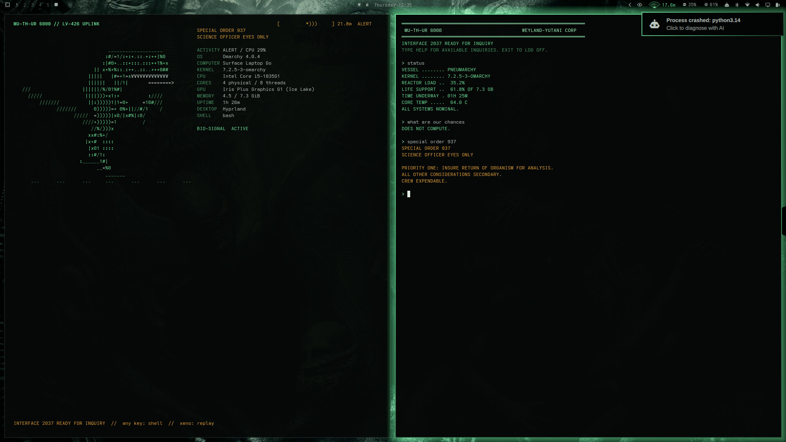
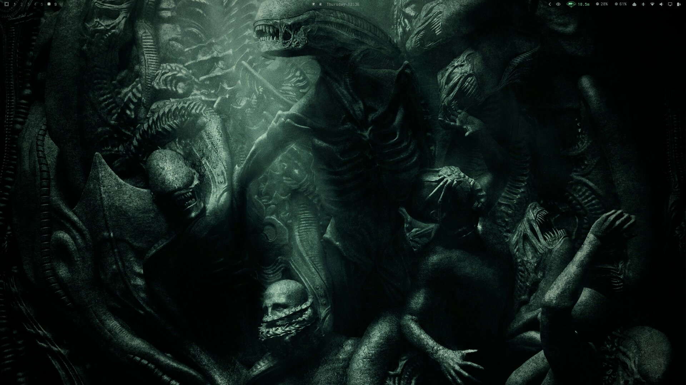
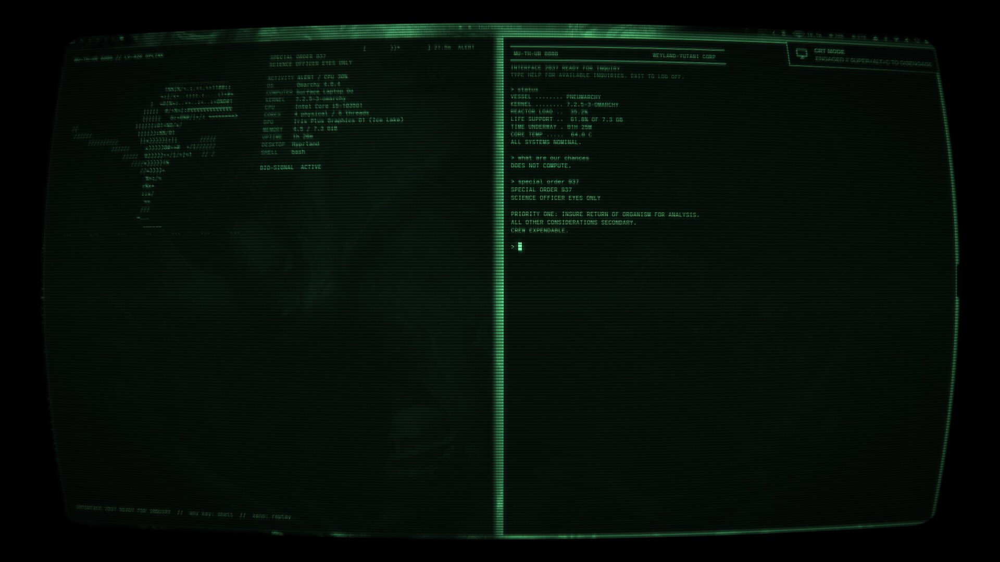
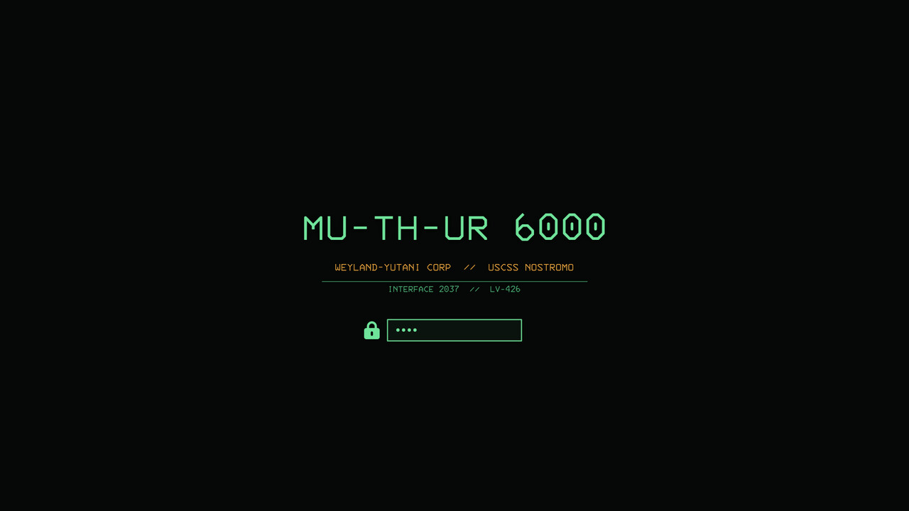
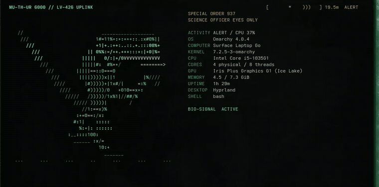
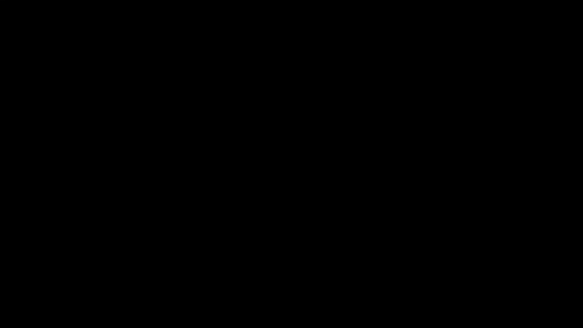
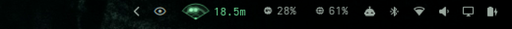

<div align="center">

# LV-426 · MU-TH-UR 6000

**An *Alien* theme for [Omarchy](https://omarchy.org): your desktop becomes the Nostromo's computer.**

Green phosphor on black · Weyland-Yutani amber · alarm red only when something is wrong.



`INTERFACE 2037 READY FOR INQUIRY`

</div>

---

LV-426 goes past colors. It adds a working MU-TH-UR console, a CRT screen
shader that powers on and off like an old tube, an M314 motion tracker in the
bar that responds to CPU load, synthesized tracker pings and klaxons, a
MU-TH-UR lock screen, and an idle "lurker" that closes in while you're away.
Every extra is **theme-gated**: it switches off when you pick another theme
and comes back when you return.

## Contents

- [Screenshots](#screenshots)
- [Features](#features)
- [Install](#install)
- [Wallpaper](#wallpaper)
- [Keybinds and commands](#keybinds-and-commands)
- [Tuning](#tuning)
- [Uninstall](#uninstall)
- [Credits](#credits)

## Screenshots

| | |
|---|---|
|  |  |
| **Desktop**: graded wallpaper, phosphor bar, M314 tracker top-right | **CRT mode** (`SUPER+ALT+C`): curved tube, scanlines, bloom, bezel |
|  |  |
| **Lock screen**: MU-TH-UR 6000 / USCSS Nostromo | **Specimen display**: the welcome on every new terminal |

<div align="center">

**CRT power-on / power-off**



**M314 motion tracker (bar widget)**: the range closes as CPU load rises



</div>

## Features

### 🟩 The look: MU-TH-UR 6000

| Role | Color | |
|---|---|---|
| Focus, selection, borders | Phosphor green | `#6FE39A` |
| Warnings, attention | Weyland-Yutani amber | `#E8A33D` |
| Errors only | Alarm red | `#D9534A` |
| Text | Bone grey | `#B8C4BC` |
| Background | Near-black | `#050806` |

- **`colors.toml`** sets terminal, editor, borders and shell colors from one palette.
- **Hand-tuned** `shell.toml` (bar, menus, notifications, lock), `btop.theme`
  (motion-tracker gradients) and `neovim.lua` (phosphor cursor).
- **Phosphor glow**: the focused window gives off a soft green glow, like light
  from a CRT. Unfocused windows get none.
- **IBM 3270 font** (`ttf-3270-nerd`) is switched in automatically. Your
  previous font comes back when you leave the theme.
- **Motion**: windows *pounce* in with an overshoot, slip out fast, and
  workspaces slide vertically like Nostromo bulkhead doors.
- **Boot and SDDM**: the MU-TH-UR logo (`unlock.png`) works with Omarchy's unlock-screen picker.

### 📺 CRT mode: `SUPER+ALT+C`

A Hyprland screen shader that puts the whole desktop on a curved
green-phosphor tube: black bezel, monochrome phosphor, thick rolling
scanlines, aperture grille, bloom, color fringe and vignette. The image
flutters slightly, and every few seconds it **browns out**, dimming and
smearing sideways.

- **Power-on**: a beat of darkness, a bright line across the middle, then the
  picture opens out overexposed and settles.
- **Power-off**: the picture collapses to a line, then a dot that fades.
- Hyprland only redraws every frame (needed for the animation) while CRT mode is
  on. Damage tracking is restored when you turn it off, so it costs no battery
  the rest of the time.
- Turns itself off when you switch themes.

### 🖥️ MOTHER console: `SUPER+ALT+M` or `mother`

Ask the ship's computer about the vessel (your machine) in plain words.
Answers are teletyped with a chirp and use **live system data**.

```
> status
VESSEL ........ PNEUMARCHY
REACTOR LOAD ..  35.2%
LIFE SUPPORT ..  61.8% OF 7.3 GB
ALL SYSTEMS NOMINAL.

> special order 937
PRIORITY ONE: INSURE RETURN OF ORGANISM FOR ANALYSIS.
ALL OTHER CONSIDERATIONS SECONDARY.
CREW EXPENDABLE.
```

Inquiries: `STATUS` `POWER` `TRACKER` `CREW` `SIGNAL` `TIME` `WEATHER`
`ORDERS` `CHANCES` `DESTRUCT` (Ctrl+C to override) · `HELP` · `EXIT`.
Use `mother --quiet` for no sound.

### 🧬 Terminal specimen display

Every new interactive terminal opens with a six-second character-art
xenomorph next to real system info, under amber **SPECIAL ORDER 937**
headings. A scan band rolls down like a CRT refresh, and a tracker strip's
blip closes in as CPU load rises.

- The creature reacts to CPU load: **PROWL** below 15%, **ALERT** below 55%, **PURSUIT** above that.
- Press any key to skip to the shell. Type `xeno` to run it continuously.
- Skipped for SSH, nested shells, non-interactive commands and other themes.
- Prompt: a MU/TH/UR [Starship](https://starship.rs) prompt (`▌MU/TH/UR :: path SECTOR branch`).

### 📡 M314 motion tracker (bar widget)

A pulsing fan with blips, driven by CPU load. The range closes from **30 m**
at idle to **1 m** at full load, and the readout turns amber under 12 m and red
under 5 m.
**Click** to toggle tracker audio, **right-click** to open btop. It hides itself
under other themes.

### 🔒 Lock screen and the lurker

- **MU-TH-UR lock screen**, based on [Hackery Lock](https://github.com/the4rchangel)
  (MIT). A large M314 tracker sits in the corner, and the longer the machine
  stays locked, the closer the contacts get.
- **Lurker**: leave the machine idle and something closes in. Distant tracker
  pings start 90 s before the screensaver and get nearer and faster at 45 s
  and 20 s. If you're still away when the screen locks, the klaxon sounds.
  Come back before then and you get `CONTACT LOST`.

### 🔊 Sounds and alerts

Every sound was synthesized with FFmpeg. None of it is film audio.

- Tracker pings at three distances, the MU-TH-UR teletype chirp, and a klaxon.
- **Notification chirp** on every desktop notification (at most one every 0.7 s).
- **Low battery**: the klaxon plus an *EMERGENCY DESTRUCT SYSTEM* warning.
- **Theme switch**: a chirp and *INTERFACE 2037 READY FOR INQUIRY*.
- **Screensaver** art switches to a MU/TH/UR 6000 banner. Yours comes back when you leave the theme.

### 🎞️ Living wallpaper (bring your own art)

`animation/wallpaper.py` plays a seamless 24-second, 30 fps cinemagraph as a
click-through background layer. It is tuned to save power:

- **Charger only**: on battery it shows the still image and never starts a decoder.
- Pauses behind fullscreen windows and while the screens are off.
- Stops when you switch themes.

See [Wallpaper](#wallpaper): the artwork itself isn't included.

## Install

**Requirements:** Omarchy 4.x (Hyprland with Lua config, Omarchy shell),
plus `ffmpeg`, `fastfetch`, `starship`, `jq`, `pipewire` (`pw-play`),
`python-gobject`, `python-cairo` and `gtk4-layer-shell`. Most of these ship
with Omarchy. The installer tells you about anything missing.

### Full install (recommended)

```bash
git clone https://github.com/Pneumatocyst/omarchy-lv-426-theme ~/.local/share/lv-426
~/.local/share/lv-426/install.sh
```

The installer copies the theme to `~/.config/omarchy/themes/lv-426`, adds the
shell plugins and hooks, adds the terminal welcome to `~/.bashrc`, offers
to install the IBM 3270 font, and asks before replacing your lock screen.

Update with `git -C ~/.local/share/lv-426 pull && ~/.local/share/lv-426/install.sh`.

### Colors only

```bash
omarchy theme install https://github.com/Pneumatocyst/omarchy-lv-426-theme
```

> [!NOTE]
> As a safety measure, Omarchy drops `.lua` files from themes installed with
> git, and it never runs a theme's hooks or plugins. This route gives you the
> palette, bar, btop, lock colors and boot logo, but **not** the glow, motion,
> CRT mode, MOTHER, tracker or sounds. Use the full install for those.

## Wallpaper

The original wallpaper was film poster art, so it isn't redistributed here.
To add your own:

1. Put a dark image in `~/.config/omarchy/themes/lv-426/backgrounds/`.
   A green tint in the shadows plus a vignette suits the palette.
2. Run `omarchy theme set lv-426`.

**Optional living wallpaper:** save a 1920×1294 PNG as
`animation/photo.png`. That turns on the player, which shows the still image.
To animate it, render `animation/creatures.mp4` with:

```bash
cd ~/.config/omarchy/themes/lv-426/animation
uv run --no-project --with numpy --with opencv-python-headless python render.py --preview=/tmp/lv
```

> [!IMPORTANT]
> `render.py` warps specific regions of the original image (rib cage, head,
> limbs, tail). These regions are set as coordinates near the top of the
> script, so retune them for your own picture first.

## Keybinds and commands

| | |
|---|---|
| `SUPER+ALT+C` | Toggle CRT mode |
| `SUPER+ALT+M` | Open the MOTHER console |
| `mother` | MOTHER in the current terminal |
| `xeno` | Run the specimen display continuously |
| `python3 ~/.config/omarchy/themes/lv-426/terminal/xenomorph.py --preview` | Preview the specimen display from any theme |

## Tuning

- **CRT**: constants at the top of `crt/crt.frag`: `CURVE`, `SCAN_PX`,
  `SCAN_DEPTH`, `MONO`, `BLOOM`, `ROLL_SPEED`, `BAND_SPEED`, `BAND_GLOW`,
  `FLICKER`, `GLITCH`, `GLITCH_DIP`.
- **Glow and motion**: `hyprland.lua` (`pounce`, `bulkhead`, `retreat` curves).
- **Palette**: `colors.toml`, plus the hand-tuned `shell.toml`, `btop.theme` and `neovim.lua`.
- **Wallpaper log**: `$XDG_RUNTIME_DIR/lv-426-$(id -u).log`. Playback state: `$XDG_RUNTIME_DIR/lv-426-playback.json`.

## Uninstall

Switch to another theme first, so your font and screensaver art are restored, then run:

```bash
~/.local/share/lv-426/uninstall.sh
```

This removes the plugins, hooks and `.bashrc` lines, and puts the Omarchy
lock screen back. The theme folder stays until you delete it.

## Credits

- Built by [Lynwood Johnson](https://github.com/Pneumatocyst) for Omarchy.
- Lock screen adapted from Hackery Lock by the4rchangel (MIT, see
  `extras/plugins/lynwood.lv426-lock/LICENSE`).
- Inspired by *Alien* (1979). A fan project, not affiliated with or endorsed
  by 20th Century Studios. "Weyland-Yutani", "Nostromo" and "MU-TH-UR" are
  used as homage.

Released under the [MIT License](LICENSE).
